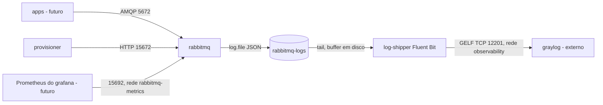

# Plano técnico — Spec 001 Broker RabbitMQ 4.x

## 1. Portão da Constituição

| Art. | Estado | Nota |
|---|---|---|
| I Idioma | ✅ | Arquivos/chaves em inglês; comentários e docs em PT-BR |
| II Simplicidade | ✅ | Sem shovel/federation/cluster; um provisionador e um coletor, ambos com justificativa |
| III Arquitetura | ✅ | Broker dono das próprias definições; apps integram por AMQP |
| IV Segurança | ⚠️ | TLS opcional em dev (ADR-0003); GELF TCP sem autenticação (herdado do Graylog) |
| V Testes | ✅ | Smoke incremental desde T02; CI executa |
| VI Observabilidade | ✅ | Health, Prometheus, logs JSON no Graylog com fallback (ADR-0004) |
| VII Confiabilidade | ✅ | Quorum, persistência, DLX, buffer de logs em disco |
| VIII Dados | ✅ | Definitions versionadas; volumes nomeados |
| IX Contratos | ✅ | Routing keys versionadas `.vN` |
| X Fluxo | ✅ | Repositório próprio, `master` + `DEV-001` |
| XI Conduta | ✅ | Opções confirmadas na doc oficial antes de usar (marcadas "a confirmar") |

## 2. Arquitetura (espelha `graylog`)

```
docker-compose.yml          rabbitmq, provisioner (one-shot), log-shipper, smoke/logs-test (profiles), tls (profile)
config/rabbitmq.conf        broker (comentários PT-BR); config/enabled_plugins
config/fluent-bit/          fluent-bit.conf (+ parsers)
definitions/definitions.template.json   vhost, policies, topologia de smoke (sem segredos)
scripts/                    generate-env, messaging-network, render-definitions, smoke-test, logs-fallback-check, backup-definitions
provisioning/               Dockerfile (alpine+curl+jq) e provision.sh (idempotente, API de management)
tests/smoke/                Dockerfile, smoke.py (pika), gelf-sink.py, logs-fallback.sh, requirements.txt (pins)
docs/integration/grafana-inputs.md
```



Redes: `workspace-messaging` (externa, apps); `rabbitmq-metrics` (interna, só broker, Prometheus entra depois); `observability` (externa, **só o shipper**).

## 3. Configuração do broker (a confirmar na doc 4.x em T02/T03/T07)

- Imagem `rabbitmq:4.3-management` por tag+digest.
- `rabbitmq.conf`: `definitions.import_backend = local_filesystem`, `definitions.local.path`, `definitions.skip_if_unchanged = true`; `loopback_users` padrão; `vm_memory_high_watermark.absolute` (~600MiB para `mem_limit: 1g`); `disk_free_limit.absolute = 1GB`; `management.tcp.ip`, `prometheus.tcp.ip`; `prometheus.return_per_object_metrics = true`; `default_queue_type` quorum (ou metadata do vhost).
- Logs (confirmado na doc): `log.console.formatter = json`, `log.file.formatter = json`, `log.file.rotation.size` + `log.file.rotation.count` + `log.file.rotation.compress` (rotação por tamanho e por data não se combinam); nível `info`.
- Volumes nomeados `rabbitmq-data`, `rabbitmq-logs`, `fluentbit-buffer`; Erlang cookie gerado no volume (single-node não compartilha; anotar para cluster).
- Healthcheck: `rabbitmq-diagnostics -q check_running` + `check_local_alarms`. Portas em `127.0.0.1`; EPMD/25672 não publicados.

## 4. Modelo de definições

Vhost `dev`; usuários `admin` (administrator) e `smoke-app` (permissões `^smoke\.`); policy `smoke-dlx` (DLX `smoke.dlx`, `delivery-limit`; at-least-once dead-lettering a confirmar); topologia de smoke: `smoke.events` (topic), `smoke.dlx`, `smoke-consumer.ping` (quorum), `smoke-consumer.ping.dlq`, binding `smoke.ping.sent.v1`. Hashes gerados pelo render a partir do `.env`; `guest` removido pelo provisionador. Import é aditivo: obsoletos saem pelo provisionador.

## 5. Segurança (STRIDE resumido)

Spoofing: guest removido, senhas aleatórias, TLS opcional (o GELF TCP do Graylog não autentica o remetente: risco herdado). Tampering: portas em loopback, redes isoladas (`rabbitmq-metrics` interna, `observability` só no shipper). Repudiation: logs de conexão/autenticação. Information disclosure: sem segredos no repo, `.env` 0600, filtro de campos e nível info nos logs. DoS: `mem_limit`, watermarks, teto do buffer de logs. Elevation: permissões por regex, tags só no admin.

## 6. Observabilidade

**Métricas** (ADR-0004): `/metrics` em 127.0.0.1:15692; rede `rabbitmq-metrics`; insumos do Grafana em `docs/integration/grafana-inputs.md`. Padrão seguido do `grafana/`: Prometheus próprio com alvos `file_sd` em `prometheus/targets/*.yml`, redes internas `metrics`/`probe`, dashboards em `provisioning/dashboards/<projeto>/` com `allowUiUpdates: false` e lint, alertas em `provisioning/alerting/rules.yaml` com pasta e labels `project`/`severity`. Dashboards: RabbitMQ-Overview 10991 rev 15, Erlang-Distribution 11352 rev 10, Erlang-Memory-Allocators 11350 rev 8 (revisões consultadas no grafana.com em 2026-11-18; revalidar). Alertas (nomes de métrica a confirmar): fila crescendo (mensagens prontas aumentando por 15 min), fila com mensagens e 0 consumidores, memória > 80% do limite ou alarme ativo, disco livre próximo de `disk_free_limit`, DLQ não vazia, `up == 0`, backlog do coletor.

**Logs com fallback** (ADR-0004, opção a): arquivo JSON rotacionado em volume (primário, sempre ativo) + `log-shipper` Fluent Bit (`tail` com `DB`, `storage.type filesystem`, GELF TCP, retry sem limite, `storage.total_limit_size`). Verificação: `scripts/logs-fallback-check.sh` (arquivo local + backlog), endpoints do coletor, healthcheck. Campos enviados: `time`, `level`, `msg`, `service_name=rabbitmq`, `tag=rabbitmq` (o pipeline do Graylog já transforma `tag` em `service_name`). LGPD: sem dados pessoais; filtro de campos. Graylog: stream/retenção/alertas só em F02.

## 7. Estratégia de testes

`scripts/smoke-test.sh` incremental: (a) portas, healthcheck, UI/API; (b) guest negado (AMQP e API); (c) permissões mínimas; (d) pika: confirm+mandatory, quorum, consume/ack, nack → DLQ, basic.return; (e) idempotência: reiniciar e reexecutar provisionador, comparar definitions; (f) métricas (`/metrics`, rede interna); (g) logs: arquivo JSON, sem segredos, shipper saudável; (h) fallback: `gelf-sink` parado/religado, eventos marcados, backlog > 0, reinício do coletor, entrega completa (duplicatas toleradas). O sink de teste evita derrubar o Graylog real. CI: shellcheck, gitleaks, trivy, smoke completo.

## 8. Riscos

Imagem Bitnami comercial (não usar); digest só no pull; imagem do Fluent Bit pode ser distroless (healthcheck por sonda externa ou variante com shell); WSL2/permissões e LF; retenção local do arquivo limitada pela rotação (parada longa do coletor pode perder arquivos rotacionados que ele não lê); pika (pin e auditoria); DLX at-least-once e `default_queue_type` a validar; single-node sem tolerância a falha; per-object metrics só para poucas filas; GELF TCP sem autenticação.

## 9. ADRs

0001 imagem e modo de execução · 0002 topologia e definitions · 0003 segurança · 0004 observabilidade (métricas + logs com fallback).
