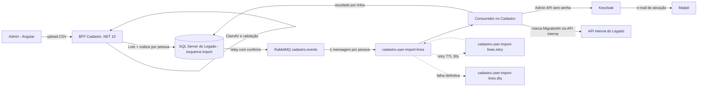

# Plano — Spec 002 Importação em lote 1x1

- **Status**: Aceito (2026-11-25). Decisões Q1-Q10 na spec §8. MVP até 04/12/2026; painéis fora do MVP.

## Visão técnica

## Decisões (ver ADRs)

| Tema | Decisão | Onde |
|---|---|---|
| Granularidade | 1 mensagem por pessoa; Outbox + relay com confirms | ADR-0005 |
| Identidade | Usuário nasce migrado, sem senha, `UPDATE_PASSWORD`, sem consultar o legado | ADR-0006 |
| Banco | Esquema `import` no `LegadoUsers` (exceção ao Art. III.4) | ADR-0007 (a escrever no `cadastro`) |
| Evento de migração | `identity.user.migrated.v1`, substitui a chamada síncrona ao Legado | ADR-0008 (depois do MVP) |
| Extração | `IExtratorDeUsuarios`; CSV no MVP, XLSX/PDF depois | spec §5 |

## Por componente

- **rabbitmq**: no `definitions.template.json`, usuário `cadastro-app` (configure nenhum; write `^(cadastro\.events|cadastro\.retry)$`; read `^cadastro\.user-import-lines$`), 3 exchanges, 3 filas quorum, 3 policies (DLX at-least-once com `overflow: reject-publish`; retry com TTL 30 s e DLX de volta à fila principal). `generate-env.sh` e `render-definitions.sh` aceitam a nova senha. Smoke ganha a seção **o**.
- **legado-cadastro-usuarios**: SQL Server na rede `workspace-data` (override de compose, sem código); chave HMAC do Cadastro autorizada só para `user-lookups` e `PUT users/{id}/migration` (a verificação de credencial segue só para o Keycloak); `legacy_app` com DENY no esquema `import`.
- **Keycloak**: client `cadastro-importer` (service account, só `manage-users`/`view-users` do realm), role `user-importer`, atributo `importLineId` no User Profile, SMTP para o Mailpit.
- **cadastro (BFF)**: `/api/v1/user-imports` (upload, confirmar, listar, detalhar, reprocessar, relatório); ClamAV; extrator CSV; Lote/Linha no esquema `import` com dados pessoais cifrados; Outbox + relay (`BackgroundService`); consumidor com inbox, retry e DLQ; cliente da Admin API com limite de 10/s; cliente da API interna do Legado (timeout, retry, circuit breaker).
- **cadastro-frontend**: telas de envio/resumo/confirmação, lista de lotes, detalhe com linhas, reprocessar e baixar relatório; aviso de conclusão (Q2).

## Ondas

| Onda | Conteúdo | Observação |
|---|---|---|
| 0 | Aprovar spec/ADRs e responder §8; spike de publicar/consumir 1 mensagem | Sem código de produção |
| 1 | R1-R3 (broker), L1-L2 (Legado), K0 (Keycloak), C1 (esquema e domínio) | Repositórios distintos: paralelizáveis |
| 2 | C2 (upload + validação + ClamAV), C3 (lote e confirmação), C4 (outbox e relay) | Mesmo repositório: sequência |
| 3 | K1/C5a (consumidor + Keycloak), C5b (inbox, retry, DLQ), C5c (marcação no Legado), F1 (tela) | C5a→C5b→C5c em sequência; F1 em paralelo |
| 4 | E1 (E2E com 5.000 linhas), painéis (opcional), README com diagrama e exemplo | Fecha o MVP |

## Riscos e mitigação

| Risco | Mitigação |
|---|---|
| Escopo maior que o prazo de 27/11 | Cortar ClamAV e painéis no MVP, ou mover a data (Q1) |
| Duplicar usuário em reentrega | Inbox por `messageId` + `importLineId` no Keycloak + chave por e-mail |
| Admin API do Keycloak saturada | Limite de 10/s e prefetch 10 |
| Vazamento de dados pessoais | Só ids na mensagem; cifra no banco; apagar ao fim; teste que varre logs |
| Conta duplicada com o Legado | Marcação só com candidato único de e-mail exato; aviso na linha |
